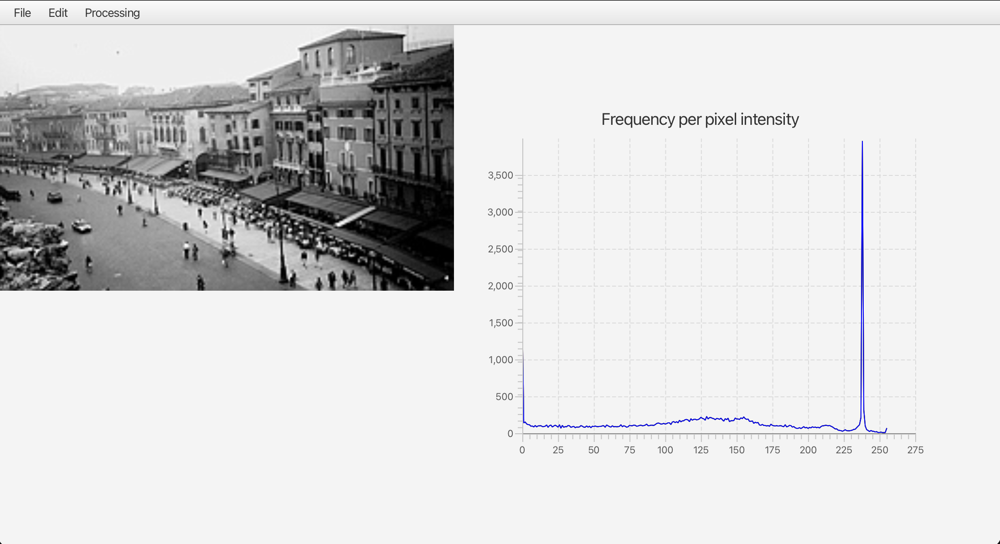
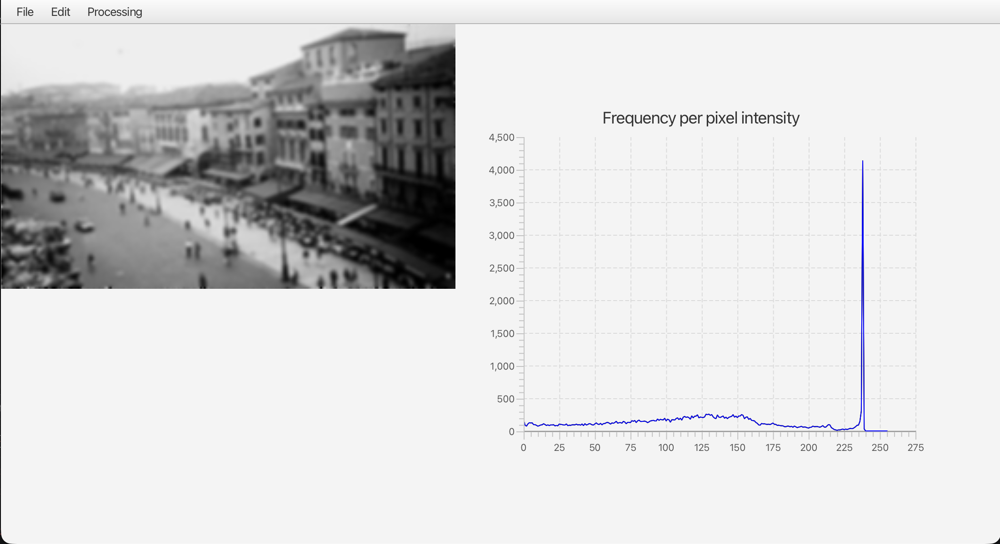
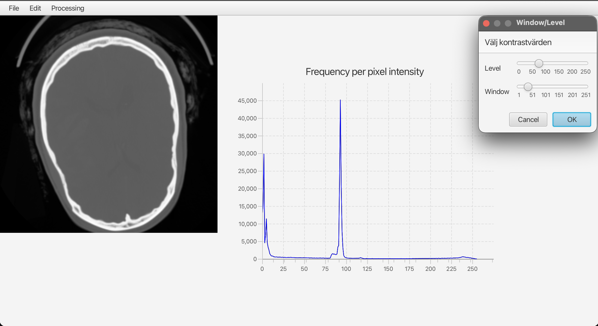
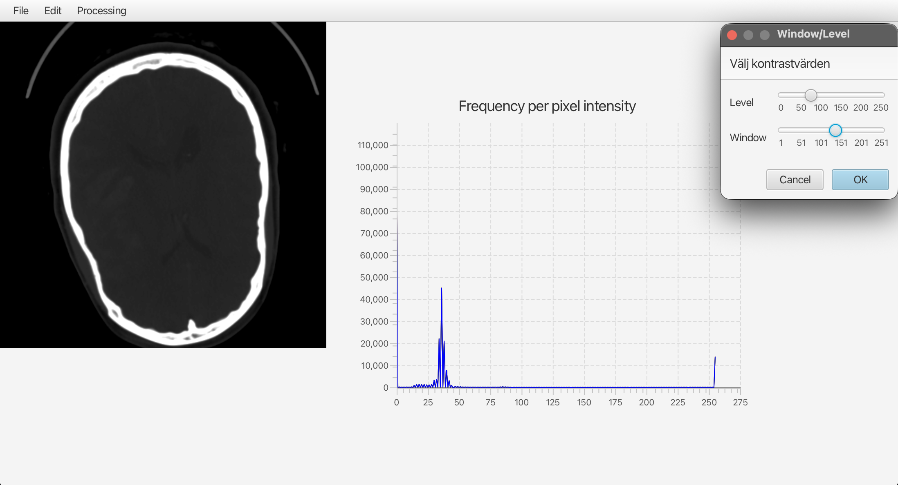

# Image Processor

A JavaFX desktop application for loading, processing and saving images,
with a live histogram of pixel intensities. Built as lab 3 in the course
HI1027 at KTH.

## Features

- Open images (PNG, JPG, BMP, GIF) and save the result as PNG
- Image processing: **GrayScale**, **Blur**, **Sharpening** and **Window/Level**
- Histogram (red, green and blue) that updates after every change
- Revert to the original image
- Menu items are disabled until an image has been loaded
- Errors are shown to the user with an `Alert` dialog

## Demo

### Blur

| Original | After Blur |
|---|---|
|  |  |

Each pixel is replaced by a weighted average of itself and its eight
neighbours, which smooths out sharp transitions.

### Window/Level (contrast)

Window/Level stretches a chosen intensity interval over the full 0–255
range. Level and window are chosen with two sliders in a dialog.
The histogram shows how the intensities are redistributed.

| Before (with dialog) | After |
|---|---|
|  |  |

## Architecture

The project follows **Model-View-Controller** with a clear separation
between the model and the view. The model contains no JavaFX code.

| Package | Classes | Responsibility |
|---|---|---|
| `model` | `ImageModelFacade`, `IPixelProcessor`, `GrayScaleProcessor`, `BlurProcessor`, `SharpeningProcessor`, `WindowLevelProcessor`, `HistogramCalculator`, `PixelConverter` | Pixel data and all calculations |
| `view` | `MainView`, `HistogramView` | Menus, image and histogram display |
| `controller` | `MainController`, `FileIO`, `ImagePixelsConverter` | Handles user actions, file I/O and conversion between `Image` and `int[][]` |
| `App` | `Main` | Creates the model, view and controller and starts the application |

### Design patterns

- **Facade:** `ImageModelFacade` is the single entry point to the model.
  It stores the original and current pixel matrices and gives the
  controller access to processing, reverting and the histogram.
- **Strategy:** every image operation implements `IPixelProcessor`.
  New operations can be added without changing existing code.

### How a menu choice is handled

1. The user selects a menu item, which creates an event.
2. The event handler in `MainView` calls the matching method in
   `MainController`, for example `onBlurSelected()`.
3. The controller passes a processor to `ImageModelFacade.applyProcessor()`.
4. The processor returns a new pixel matrix (`int[][]`).
5. The controller converts the matrix to an `Image`, then updates the
   image and the histogram in the view.

## Image processing methods

| Method | Description |
|---|---|
| GrayScale | Sets red, green and blue to the average of the three channels |
| Blur | Weighted average over a 3×3 area (weights 1 2 1 / 2 4 2 / 1 2 1, divided by 16) |
| Sharpening | Adds the difference between the original and a blurred version to the original, clamped to 0–255 |
| Window/Level | Intensities below `level` become 0, above `level + window` become 255, and values in between are scaled linearly to 0–255 |

## Requirements

- Java 17 or later
- JavaFX with the modules `javafx.controls`, `javafx.fxml` and `javafx.swing`

## Run

Open the project in IntelliJ IDEA and run `App.Main`.

## Notes

- Sharpening and Window/Level are intended for grayscale images, since
  they only read the red channel. Run GrayScale first on color images.
- In Blur, the outermost pixels of the image are copied unchanged.

## Author

Matinrashid – KTH, HI1027
